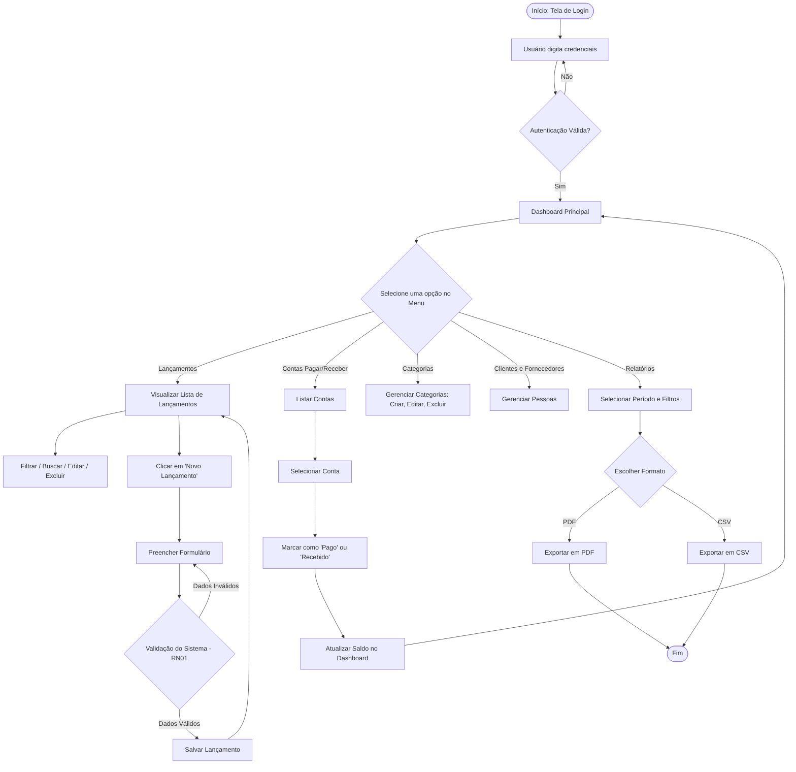

# Fluxo do Usuário e Diagrama de Processo

## Descrição do Fluxo

1. **Autenticação:** O usuário realiza o login com suas credenciais e é redirecionado para o **Dashboard**.
2. **Navegação Principal:** No menu do sistema, o usuário pode navegar entre as seções: *Lançamentos*, *Contas a Pagar/Receber*, *Categorias*, *Clientes/Fornecedores* ou *Relatórios*.
3. **Gestão de Lançamentos:**
   - Na tela de *Lançamentos*, seleciona "Novo Lançamento".
   - Preenche o formulário com dados obrigatórios.
   - O sistema valida as regras de negócio (ex.: RN01 - validação de campos obrigatorios e valores) e salva os dados.
   - O lançamento é exibido na listagem principal, onde pode ser filtrado, editado ou excluído.
4. **Liquidação de Contas:**
   - Em *Contas a Pagar/Receber*, o usuário localiza o título desejado e o marca como "Pago" ou "Recebido".
   - O sistema atualiza o status da conta e recalcula automaticamente os saldos do *Dashboard*.
5. **Geração de Relatórios:**
   - Na seção de *Relatórios*, o usuário define o período e filtros desejados.
   - Seleciona o formato de exportação (PDF ou CSV) e realiza o download.

---

## Diagrama do Fluxo de Usuário

